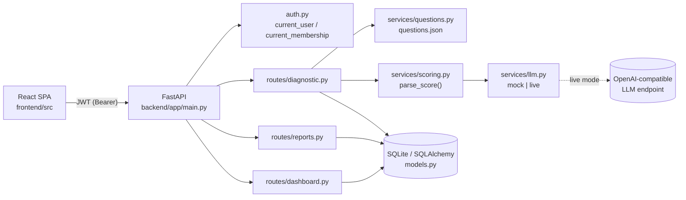

# Architecture

## Context and goals
AI Pulse measures how well employees use AI at work. Two audiences: **employees** (take a diagnostic, get a personal report) and **org admins** (see team-level maturity and risks). It's multi-tenant: one deployment serves several organizations, and some users belong to more than one.

The two properties that must always hold:
1. **Data never crosses organizations.** ([ADR-001](decisions/ADR-001-org-scope-from-token.md))
2. **Leadership never sees a group small enough to identify people.** ([ADR-002](decisions/ADR-002-minimum-group-size.md))

## Components

| Layer | Files | Responsibility |
|---|---|---|
| Routes | `app/routes/*.py` | HTTP, validation, authorization |
| Auth | `app/auth.py` | password hashing, JWT, resolving the caller's membership |
| Services | `app/services/*.py` | question selection, LLM call, parsing AI output, risk catalog (labels + actions) |
| Data | `app/models.py`, `app/db.py` | Organization, Department, User, Membership, Response |
| Config | `app/config.py`, `.env` | env vars, `MIN_GROUP_SIZE`, secrets |

## Data model
- `User` 1—n `Membership` n—1 `Organization`. **Membership is the tenant boundary**: it holds role (`admin`/`employee`), department, job role and seniority *per org*.
- `Response` belongs to a **membership**, not a user. A consultant's answers for Northwind and Bluepeak are separate.
- Scores (`Response.score`) are 1–5 or `NULL` (unscored). Flags are a JSON list from a fixed whitelist.

## Request flows

**Login → select org**
1. `POST /auth/login` returns a token with no org, plus the org list.
2. `POST /auth/select-org` checks membership and returns a token with `org`.
3. Every org-scoped endpoint depends on `current_membership`, which loads the membership for (`sub`, `org`) on each request.

**Diagnostic → report**
1. `GET /diagnostic/questions` returns `questions_for(job_role, seniority)`, with points stripped.
2. `POST /diagnostic/submit` validates against that same set. MCQ answers are scored by option points; the open answer goes through `llm.score_answer` → `parse_score` ([ADR-004](decisions/ADR-004-untrusted-ai-output.md)). The previous answers are replaced ([ADR-005](decisions/ADR-005-submission-rules.md)).
3. `GET /reports/me` averages the non-null scores and maps them with `utils.maturity_level`.

**Dashboard**
One joined query (responses × memberships for the org) → per-person averages → group by department → apply the min-group rule → risks and overall from visible people only → each risk is enriched from `services/risks.py` with label, the visible teams it's in, and a team action ([ADR-007](decisions/ADR-007-risk-to-action.md)).

## Maturity scale (single source: `app/utils.py`)
| Average | Level |
|---|---|
| < 2 | Beginner |
| 2 – < 3 | Exploring |
| 3 – < 4 | Practitioner |
| ≥ 4 | Leader |

## Known limits
SQLite and `create_all` (no migrations); tokens in localStorage with no revocation; no login rate limiting. See [AUDIT.md](AUDIT.md) → "Deliberately left".
